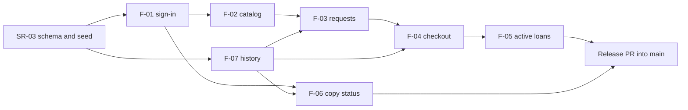

# Three-Sprint Plan

Product: Lab Equipment Borrowing System
Sources: [SRS v0.5](../srs.md), [Feature inventory v0.1](../features.md), [Traceability v0.1](../traceability.md), [System-Level SDS v0.1](../system-sds.md)
Issue: #4

## Version history

| Version | Date | Author | Change |
| --- | --- | --- | --- |
| 0.1 | 2026-11-05 | @ArmmyC | First three-sprint plan for teammate review. The owner allocation and dated targets are proposals until the review accepts them. Includes fixes from an independent check against the Deliverable 1 and 2 briefs, the course calendar, and the merged documents, and from the PR #11 review: a second Sprint 1 decision point, the release PR owner, the Prisma 7 upgrade on 15 Nov, the Lab 7 change on 28 Nov, and the Lab 7 lead moved to @ArmmyC. |

## 1. How to read this plan

- Feature (F-xx) and system responsibility (SR-xx) IDs come from [features.md](../features.md). This plan assigns each one a sprint, a target date, and an owner. It does not repeat their requirements.
- The owner writes the feature's contract and implements it, and the other member reviews. Each feature PR starts with a contract-only commit, then the failing tests, then the implementation, so the contract is versioned before the code and the TDD order is visible.
- A sprint is done when its completion outcome holds and every feature in it meets the Product Definition of Done in its contract: behavior implemented, planned verification run and passing, reviewed and integrated, documents and setup current, and any incomplete work disclosed.
- Dates are merge targets into the staging branch. A missed date is raised in the Issue on the same day, and section 8 says how scope changes.

## 2. Calendar and releases

| Sprint | Window | Staging branch | Checkpoint |
| --- | --- | --- | --- |
| 1 | 3 Nov to 8 Nov | `sprint-1`, cut from `main` | Deliverable 1, 8 Nov 23:59 |
| 2 | 9 Nov to 24 Nov | `sprint-2`, cut from `main` after `v0.1.0` | Sprint 2 complete before Deliverable 2 |
| 3 | 18 Nov to 13 Dec | `sprint-3`, cut from `sprint-2` once F-10 merges (target 18 Nov) | Progress at Deliverable 2 (29 Nov), final delivery 13 Dec |

Sprint 3 starts while Sprint 2 finishes because the course calendar asks for a substantially complete product by 29 Nov, and the final examination period (1 to 11 Dec) leaves only fixes and verification after it. After each later Sprint 2 merge, `sprint-2` is merged forward into `sprint-3` on the same day.

The SDS (section 10) deploys only from `main`, and the labs need deployed releases before 29 Nov. Every merge into `main` is a reviewed release PR from a staging branch, which holds only complete, reviewed work, and gets a tag:

| Tag | Target | From | Contents |
| --- | --- | --- | --- |
| `v0.1.0` | 8 Nov | `sprint-1` | Sprint 1 release for Deliverable 1 |
| `v0.2.0-rc.1` | 15 Nov | `sprint-2` | Lab 5: Docker image, CI, `/api/ready`, first GCP deployment |
| `v0.2.0-rc.2` | 22 Nov | `sprint-2` | Lab 6: accepted UAT defect fixes, redeployed for the re-test |
| `v0.2.0` | 24 Nov | `sprint-2` | Sprint 2 complete |
| `v0.3.0-rc.1` | 29 Nov | `sprint-3` | Deliverable 2 candidate: Sprint 2 plus implemented Sprint 3 work and the Lab 7 change |
| `v1.0.0` | 13 Dec | `sprint-3` | Final product |

Group labs run alongside the sprints in the same repository:

| Lab | Due | Work it adds | Lead | Lands in |
| --- | --- | --- | --- | --- |
| Lab 5 | 15 Nov | Docker image, CI on every PR, GCP deployment (SDS section 10) | @Bank848 | Sprint 2 (SR-04 on GCP, SR-05) |
| Lab 6 | 22 Nov | Cross-team UAT and defect management | @ArmmyC | Sprint 2 |
| Lab 7 | 29 Nov | Maintenance change, metrics, release readiness | @ArmmyC | Sprint 3 candidate |

The lead runs the lab and its PRs, and the other member reviews and joins the required group activities.

## 3. Sprint 1: working domain slice

### 3.1 Goal

A borrower and a custodian log in with seeded accounts, and the borrower's request becomes a loan with a correct due date through the UI, API, and database. Access rules and business rules are enforced on the server and covered by automated tests.

### 3.2 Scope and schedule

| ID | Item | Proposed owner | Depends on | Merge target |
| --- | --- | --- | --- | --- |
| SR-03 | Prisma schema, SQL constraints, and seed for all Sprint 1 tables | @ArmmyC | None | 6 Nov morning |
| F-07 | Status history recording | @Bank848 | SR-03 | 6 Nov |
| F-01 | Sign-in, session, and current user, with the SR-01 and SR-02 middleware | @ArmmyC | SR-03 | 6 Nov |
| F-02 | Equipment catalog | @Bank848 | F-01 | 7 Nov morning |
| F-06 | Copy maintenance status | @Bank848 | F-01, F-07 | 7 Nov |
| F-03 | Borrow requests, including borrower cancel | @ArmmyC | F-01, F-02, F-07 | 7 Nov |
| F-04 | Custodian checkout with Bangkok due date | @Bank848 | F-03, F-07 | 8 Nov morning |
| F-05 | Active loan list | @ArmmyC | F-04 | 8 Nov afternoon |
| SR-01, SR-02, SR-04, SR-07 | Checks in `system-checks.md` | @ArmmyC | F-01 | 8 Nov |
| Release | Release PR, `v0.1.0`, recorded build and test results | @ArmmyC writes, @Bank848 reviews | Everything above | 8 Nov evening |

The gaps on the critical path are used for contracts, so nobody waits idle:

| Day | @ArmmyC | @Bank848 |
| --- | --- | --- |
| 5 Nov | SR-03 schema and seed | F-07 and F-02 contracts |
| 6 Nov | F-01, then the F-03 contract | F-07, then the F-06 and F-04 contracts |
| 7 Nov | F-03, then `system-checks.md` and the F-05 contract | F-02, then F-06 |
| 8 Nov | F-05 (started on the F-04 branch), release PR, Part F evidence | F-04, review of F-05 and the release PR |

This covers the Issue #4 scope: authentication and roles (F-01), catalog (F-02), borrow request and borrower cancel (F-03), checkout with due date (F-04), active loan view (F-05), copy maintenance status (F-06), history recording (F-07), and access and rule tests (SR-01 and the AC in each contract).

### 3.3 Build order

The critical path is SR-03, F-01, F-02, F-03, F-04, F-05, six merges that alternate between the owners. Each owner builds the next item on the branch of the one still in review and rebases after it merges, so a review never stops the other person's work.

### 3.4 Completion outcome

- The release PR from `sprint-1` into `main` is reviewed and merged, and `v0.1.0` marks the release commit.
- The domain journey works end to end: a borrower requests a type, a custodian records checkout, and the borrower sees the active loan with its asset tag and due date (TEST-E2E-01).
- Each planned Sprint 1 AC in [traceability.md](../traceability.md) section 4 is verified on the release commit by an automated test or, where the traceability names a manual check, a recorded manual check. Build, lint, and test results are recorded against that commit.
- Login, logout, and current user work for both roles. Protected endpoints return 401 without a session, and wrong-role and wrong-owner calls return 403 and 404.
- A fresh clone reaches the seeded app with the README commands.

### 3.5 Why this scope is feasible

- The baseline is already reviewed and merged into `sprint-1`: the scaffold with its test setup (PR #7), the SRS (PR #6), the feature inventory and traceability (PR #9), and the System-Level SDS (PR #10). The SDS fixes the data model, endpoints, error codes, and the checkout and request transactions, so each contract reuses those decisions instead of making new ones.
- Most features are thin. F-05 and F-06 each add one or two endpoints and one screen. F-02 adds two read-only screens, the catalog and the type detail.
- The rule logic sits in F-03 and F-04 (9 AC each), which run back to back at the end of the path. They have different owners, and their transactions are already designed in SDS section 2.5.
- Two roles, two labs, and seeded accounts keep account administration out, as the brief allows.
- Sprint 1 has only two small state machines: requests go from Pending to Fulfilled or Cancelled, and copies move between Available, On loan, and In maintenance. Return, rejection, overdue, limits, and inventory editing wait for Sprint 2.
- Deployment is not in Sprint 1. The brief puts Docker, CI, and GCP in Lab 5, and the SDS already designs for it.

### 3.6 If Sprint 1 runs short

Three days remain for seven features, and F-04, the hardest feature, comes last. The plan sets two decision points, each recorded in Issue #4:

- End of 6 Nov: if SR-03 and F-01 are not merged, both members decide on 7 Nov morning what moves.
- End of 7 Nov: if F-03 is not merged, or F-02 and F-06 are both still open, both members decide that evening what moves. @ArmmyC then writes the F-04 concurrency test while @Bank848 writes the checkout service, so F-04 can still merge on 8 Nov.

What moves, in this order, as agreed in the PR #6 and PR #11 reviews:

1. F-07 history recording (FR-17) moves to Sprint 2 first. It needs an SRS change to FR-17 and D-11 approved by both members, and AC-F07-01 and AC-F07-02 move with it. F-03, F-04, and F-06 then add their history writes in Sprint 2, and the Lab 6 UAT case that D-11 gives as the reason for early recording would see no Sprint 1 history.
2. F-06 copy maintenance status moves second, because it is not part of the domain journey. It needs an SRS change to FR-16 and BR-08.
3. F-01 to F-05 and the access checks are not cut. If one is still incomplete on 8 Nov, the release discloses it as incomplete under the Product Definition of Done instead of claiming it.

@ArmmyC writes the release PR in every case. It opens as a draft on 8 Nov at 18:00 with what is merged, work merged by 21:00 goes into `v0.1.0`, and anything still open is listed as incomplete in the PR and the Deliverable 1 report.

## 4. Sprint 2: core expansion

### 4.1 Goal

Complete the loan lifecycle and the custodian's inventory tools under engineering contracts, on a release deployed on GCP through the Lab 5 pipeline.

### 4.2 Scope and schedule

| ID | Item | Proposed owner | Depends on | Merge target |
| --- | --- | --- | --- | --- |
| SR-05, SR-04 (GCP) | CI quality gate, then GCP deployment with durability after restart and redeploy (Lab 5) | @Bank848 | Sprint 1 release | 15 Nov |
| #8 | Prisma 7 upgrade, after `v0.2.0-rc.1` is tagged so the Lab 5 release does not carry it | @ArmmyC | SR-05 | 15 Nov |
| F-09 | Loan return | @ArmmyC | F-04 | 14 Nov |
| F-10 | Overdue status | @ArmmyC | F-05 | 17 Nov |
| F-08 | Request rejection | @Bank848 | F-04 | 17 Nov |
| F-15 | Login rate limit | @ArmmyC | F-01 | 19 Nov |
| F-12 | Equipment type management | @Bank848 | F-02 | 19 Nov |
| F-11 | Borrowing limits | @ArmmyC | F-03, F-04, F-10 | 21 Nov |
| F-13 | Copy inventory management | @Bank848 | F-06 | 21 Nov |
| F-14 | Status history view | @ArmmyC | F-07 | 23 Nov |
| SR-06 | 80% line coverage of request, checkout, return, and rule services | Both | F-09, F-11 | 24 Nov |

Contracts for F-08 to F-15 are written in the first days of the sprint, before each feature starts. F-10 comes early because F-11, F-16, and F-19 depend on it. F-09 comes early because F-18 and the SR-06 coverage target depend on it.

### 4.3 Completion outcome

- Every Sprint 2 feature is complete, reviewed, integrated on `sprint-2`, and verified against its contract.
- `main` carries `v0.2.0`, deployed on GCP by the pipeline with a manual approval, and data survives a restart and a redeploy.
- The Sprint 1 journey, login, backend permissions, and record ownership still pass as regression tests.
- Lab 6 UAT defects are recorded with their status, and the accepted ones are fixed, redeployed, and re-tested.

## 5. Sprint 3: remaining features and hardening

### 5.1 Goal

Finish the product baseline before the examination period, then harden it for the final release: response time on the deployed app, full regression, UAT re-tests, and final documents.

### 5.2 Scope and schedule

| ID | Item | Proposed owner | Depends on | Target |
| --- | --- | --- | --- | --- |
| Contracts | F-16 to F-19 contracts and the SR-08 verification specification | F-16, F-18 @ArmmyC. F-17, F-19, SR-08 @Bank848. | Feature inventory | 22 Nov |
| F-16 | Loan renewal | @ArmmyC | F-04, F-10 | 25 Nov |
| F-19 | Inventory summary | @Bank848 | F-05, F-10, F-13 | 27 Nov |
| F-17 | Search and filter | @Bank848 | F-02, F-04, F-05 | 28 Nov |
| F-18 | Copy and borrower loan history | @ArmmyC | F-07, F-09 | 28 Nov |
| Lab 7 change | The maintenance change chosen in Lab 7, merged a day before the candidate so CI failures can be fixed | @ArmmyC | Lab 7 sheet | 28 Nov |
| SR-08 | Response time of the catalog and request list on the deployed app | Both | F-02, F-03, deployed release | 30 Nov |
| Hardening | Full regression, UAT re-tests, defect fixes, README and setup review, final documents and video | Both | All features | 12 to 13 Dec |

### 5.3 Progress by 29 Nov

Deliverable 2 needs specified and tested Sprint 3 progress:

- The contracts for F-16 to F-19 and the SR-08 verification specification are written and reviewed.
- F-16, F-19, F-17, and F-18 are implemented and tested in the `v0.3.0-rc.1` candidate. F-16 alone would meet the minimum, but the calendar expects a substantially complete product by 29 Nov.
- The remaining-work list names every open feature, AC, and defect with its owner, dependencies, next action, and target date.

### 5.4 Completion outcome by 13 Dec

- Every feature F-01 to F-19 and every responsibility SR-01 to SR-08 is complete and verified, or listed with an explicit status.
- `main` carries `v1.0.0`, and the same version runs on GCP with durable data and current setup instructions.
- Automated regression, UAT re-tests, and the SR-08 measurement are recorded against the release commit.

## 6. Coverage of the product baseline

Every feature and system responsibility in [features.md](../features.md) is established in exactly one sprint, so the three sprints cover every FR, BR, and NFR mapped there. [traceability.md](../traceability.md) section 5 confirms that no requirement is uncovered.

| Sprint | Features | System responsibilities established |
| --- | --- | --- |
| 1 | F-01 to F-07 (7) | SR-01, SR-02, SR-03, SR-04, SR-07 |
| 2 | F-08 to F-15 (8) | SR-05, SR-06 |
| 3 | F-16 to F-19 (4) | SR-08 |

SR-04 is established locally in Sprint 1 and verified again on GCP in Sprint 2. Requirements split across sprints, such as FR-14, FR-16, FR-17, BR-05, BR-06, and BR-08, follow the parts listed in traceability section 5. Each SR is verified again in later sprints as stated in features.md section 2.

## 7. Allocation summary

| Member | Sprint 1 | Sprint 2 | Sprint 3 | Labs |
| --- | --- | --- | --- | --- |
| @ArmmyC | SR-03, F-01, F-03, F-05, `system-checks.md`, release PR | #8, F-09, F-10, F-11, F-14, F-15 | F-16, F-18, Lab 7 change | Lab 6 and Lab 7 lead |
| @Bank848 | F-07, F-02, F-06, F-04 | SR-05, SR-04 on GCP, F-08, F-12, F-13 | F-17, F-19, SR-08 specification | Lab 5 lead |

Each member reviews every PR the other opens. Pair work, such as SR-06, SR-08, and the final hardening, is named in its Issue and PR.

## 8. Risks and changes to this plan

| Risk | Effect | Response |
| --- | --- | --- |
| Sprint 1 has three days left for seven features | Incomplete Sprint 1 release | Day schedule in 3.2, and the 6 Nov and 7 Nov decision points in 3.6 |
| Lab 5 needs a GCP project with working billing | Deployment slips past 15 Nov | Set up the project on 9 Nov, and ask the TA at once if no account works |
| Q-05 (lab-scoped custodian access) is still open with the TA | BR-15 and SR-01 change | Record the TA's answer in the SRS before the Sprint 1 release PR. A change goes through the SRS and traceability before code changes. |
| Sprint 2 and the labs share three weeks | Sprint 3 progress is thin at 29 Nov | Sprint 3 contracts by 22 Nov, and `sprint-3` starts on 18 Nov |
| Final exams take 1 to 11 Dec | Little time after 29 Nov | All features are targeted by 28 Nov, and only SR-08 and hardening come after |
| Prisma 7 upgrade (#8) touches every database call | Regressions mid-sprint | Merged on 15 Nov, right after the CI gate and the Lab 5 tag, so only F-09 merges before it and every later feature is tested on Prisma 7 |

A change to sprint scope, order, owner, or target date is agreed by both members in an Issue or PR, recorded in this file's version history, and reflected in [features.md](../features.md) and [traceability.md](../traceability.md) in the same PR.
