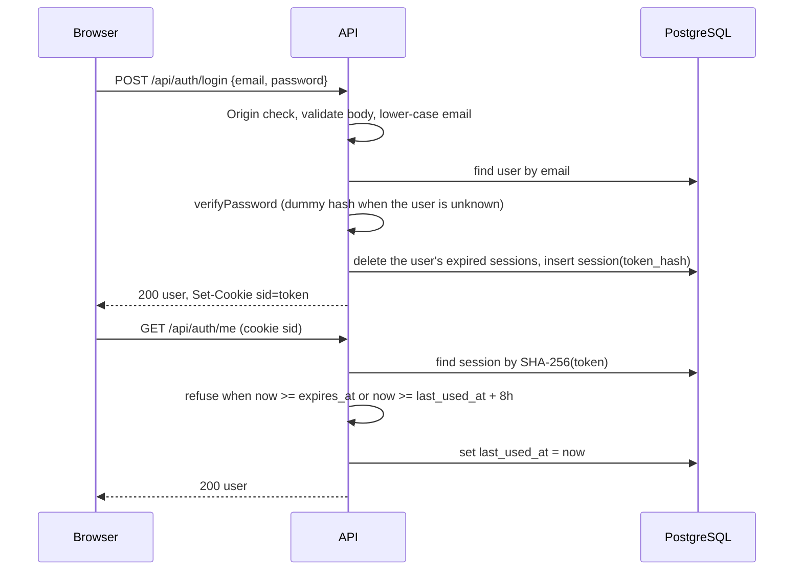

# F-01 Sign-in, Session, and Current User

Product: Lab Equipment Borrowing System
Issue: #14
Owner: @ArmmyC, reviewer @Bank848
Requirements: FR-01, FR-02, FR-03, NFR-01, NFR-04
Also builds: SR-01 (authorization) and SR-02 (error shape), specified in [system-checks.md](system-checks.md)
Sources: [SRS](../../srs.md) sections 3 and 4, [System-Level SDS](../../system-sds.md) sections 2.3, 4, 5, 6.2, 7, and 8, [Traceability](../../traceability.md) section 4

## Version history

| Version | Date | Author | Change |
| --- | --- | --- | --- |
| 0.1 | 2026-11-07 | @ArmmyC | First contract, written before the tests (#14). |

## 1. Feature-Level SDS

### 1.1 Purpose

Seeded users log in with email and password, see their name and role, stay signed in after a page reload, and log out. Every later Sprint 1 feature relies on the session, the role check, and the error shape built here.

### 1.2 Components

| Component | File | Responsibility |
| --- | --- | --- |
| Clock | `server/src/clock.ts` | `Clock` type with `now()`. Production uses the system clock, and tests pass a fixed one (SDS 8). |
| Passwords | `server/src/auth/password.ts` | `hashPassword` (from SR-03) and `verifyPassword`, which compares with `timingSafeEqual` and returns `false` for a malformed stored hash (SDS 7.1) |
| Session service | `server/src/auth/sessions.ts` | Login, session lookup with expiry, and logout. Reads time only from the clock. |
| Auth routes | `server/src/auth/routes.ts` | Translates HTTP to service calls, sets and clears the cookie |
| Middleware | `server/src/http/` | Origin check, `requireSession`, `requireRole`, body validation, and the error mapper |
| Route table | `server/src/routes.ts` | Every API route with its method, path, and access (`public`, `signed-in`, `BORROWER`, or `CUSTODIAN`). The app registers routes only from this table (SDS 6.2). |
| Allowed origins | `server/src/origins.ts` | Parses `APP_ORIGIN` and applies the unset rules from SDS 7.4 |
| Shared schemas | `shared/src/auth.ts` | `loginRequestSchema`, `currentUserSchema`, and `roleSchema`, used by both the API and the UI |
| UI | `client/src/` | API client, auth context, login page, header, and route guards |

### 1.3 Request flow

Every `/api` request passes, in order: helmet and the 100kb JSON limit, the Origin check for `POST`, `PUT`, `PATCH`, and `DELETE`, then the route's access middleware, then validation, then the handler. Any error goes to one error mapper that writes the shared error shape (SDS 2.3 and 5.3).

### 1.4 Session rules

| Rule | Value |
| --- | --- |
| Token | 32 random bytes, base64url, sent only in the cookie |
| Stored | `session.token_hash` is the SHA-256 hex digest of the token. The token itself is never stored or logged. |
| Created | `created_at` and `last_used_at` are `now`, and `expires_at` is `now` plus 24 hours |
| Accepted | `now < expires_at` and `now < last_used_at + 8 hours`. An accepted request sets `last_used_at` to `now`. |
| Refused | A missing, unknown, or expired session gets 401 `UNAUTHENTICATED`. An expired row is deleted when found. |
| Cookie | `sid`, `HttpOnly`, `SameSite=Lax`, `Path=/`, `Max-Age=86400`, and `Secure` when `NODE_ENV=production` |
| Logout | Deletes the session row and clears the cookie |
| Cleanup | A successful login deletes that user's expired sessions |

### 1.5 Data

F-01 uses the `user` and `session` tables from SR-03 and adds no migration.

## 2. API specification

| Method and path | Access | Request | Success | Errors |
| --- | --- | --- | --- | --- |
| `POST /api/auth/login` | Public | `{ "email": string, "password": string }` | 200 with the current user, and the `sid` cookie | 400 `VALIDATION_ERROR`, 401 `INVALID_CREDENTIALS`, 403 `INVALID_ORIGIN` |
| `POST /api/auth/logout` | Signed in | No body | 204, and the cookie is cleared | 401 `UNAUTHENTICATED`, 403 `INVALID_ORIGIN` |
| `GET /api/auth/me` | Signed in | None | 200 with the current user | 401 `UNAUTHENTICATED` |

The current user is `{ "id": number, "name": string, "email": string, "role": "BORROWER" | "CUSTODIAN" }`. No other field, such as the password hash, is returned.

Login validation, in `loginRequestSchema`:

| Field | Rule | Message |
| --- | --- | --- |
| `email` | Required after trimming, at most 254 characters, a valid email address. Compared lower-case. | "Enter your email address." or "Enter a valid email address." |
| `password` | Required, at most 200 characters | "Enter your password." or "Use a password of at most 200 characters." |

A wrong email and a wrong password both return 401 `INVALID_CREDENTIALS` with the message "Email or password is incorrect.", and create no session (FR-01).

Error codes added by this feature, all in the shared shape:

| Status | Code | Message |
| --- | --- | --- |
| 400 | `VALIDATION_ERROR` | "Check the highlighted fields.", with `fields` |
| 401 | `UNAUTHENTICATED` | "Sign in to continue." |
| 401 | `INVALID_CREDENTIALS` | "Email or password is incorrect." |
| 403 | `FORBIDDEN` | "You do not have access to this action." |
| 403 | `INVALID_ORIGIN` | "This request came from an origin that is not allowed." |
| 413 | `PAYLOAD_TOO_LARGE` | "The request body is too large." |

## 3. UI specification

| Screen or part | Behaviour |
| --- | --- |
| Session restore | On load the app calls `GET /api/auth/me` and shows a loading message until it answers. 200 signs the user in, and 401 shows the login page. Any other failure shows "Could not reach the server." with a Retry button. |
| Login page `/login` | Email and password fields with labels. Submitting validates with `loginRequestSchema` first and shows each message under its field. The Log in button is disabled while the request is in flight. A 401 shows "Email or password is incorrect." above the form. The page also shows the system status line from the scaffold. |
| After login | A borrower goes to `/catalog`, and a custodian to `/custodian/requests` (SDS 4.1). Until F-02 and F-04 build them, these routes show the page title and "This page is not built yet." |
| Header | When signed in, shows the user's name, the role as "Borrower" or "Custodian", and a Logout button on every page |
| Logout | Calls the logout endpoint, then shows the login page. A 401 from logout is treated the same, since the session is already gone. |
| Route guards | Signed out, every route except `/login` goes to `/login`. A route for the other role goes to the user's home page. `/` goes to the user's home page. These guards are for usability only, and the API checks every permission again. |

## 4. Acceptance criteria

These are the AC from [traceability.md](../../traceability.md) section 4, unchanged.

| AC | Requirements | Observable outcome |
| --- | --- | --- |
| AC-F01-01 | FR-01 | A seeded user with the correct email and password gets a session cookie and sees their name and role. |
| AC-F01-02 | FR-01 | A wrong email or a wrong password returns the same generic message, and no session is created. |
| AC-F01-03 | FR-02, NFR-04 | After logout the session row is deleted, and reusing the old cookie returns 401. |
| AC-F01-04 | FR-03 | The current-user endpoint returns id, name, email, and role with a valid session, and 401 without one. After a page reload the UI still shows the logged-in user. |
| AC-F01-05 | NFR-01 | The stored password is a salted scrypt hash, and the same password hashed twice gives different hashes. |
| AC-F01-06 | NFR-04 | A session used just before 8 hours of inactivity is still accepted. A session is refused after 8 hours without use, and after 24 hours from login even when used. |
| AC-F01-07 | NFR-04 | The session cookie is httpOnly and `SameSite=Lax`, and also `Secure` when `NODE_ENV=production`. The session row stores a hash of the token, not the cookie value. |
| AC-F01-08 | NFR-04 | A state-changing request whose `Origin` header is not in `APP_ORIGIN` gets 403 `INVALID_ORIGIN` and changes nothing. The same request with an allowed `Origin` succeeds, and one with no `Origin` header is not refused by this check. |

## 5. Test specifications

API tests run against the test database with a fixed clock that starts at `2026-11-07T02:00:00Z`. Each test creates its own users with a known password.

| Test | AC | Level | Precondition or input | Action | Expected result |
| --- | --- | --- | --- | --- | --- |
| TEST-F01-01 | AC-F01-01 | API, UI | A borrower and a custodian | Log in as each with the correct password, with the email in mixed case for one of them. Render the app after a successful login. | 200 with `id`, `name`, `email`, and `role`, a `sid` cookie, and one session row. The header shows the name and the role label. |
| TEST-F01-02 | AC-F01-02 | API, UI | A borrower | Log in with a wrong password, then with an unknown email | Both return 401 `INVALID_CREDENTIALS` with the same message, no cookie, and no session row. The login page shows the message above the form. |
| TEST-F01-03 | AC-F01-03 | API | A signed-in borrower | Log out, then call `GET /api/auth/me` with the old cookie. Call logout with no cookie. | Logout returns 204 and a cookie that expires the `sid`. The session row is gone. The old cookie and the call without a cookie get 401 `UNAUTHENTICATED`. |
| TEST-F01-04 | AC-F01-04 | API, UI | A signed-in borrower | Call `GET /api/auth/me` with the cookie, with no cookie, and with an unknown token. Render the app when `me` returns a user and when it returns 401. | 200 with exactly `id`, `name`, `email`, and `role`. 401 `UNAUTHENTICATED` for the other two. The UI shows the user, or the login page. TEST-E2E-02 covers the reload in a browser. |
| TEST-F01-05 | AC-F01-05 | Unit, API | A stored hash from `hashPassword` | Verify the right password, a wrong password, and a malformed stored value. Log in as a user created with `hashPassword`. | `true`, `false`, and `false` without throwing. Login succeeds, and the stored value has the `scrypt$16384$8$1$` format. The SR-03 tests already check that two hashes of one password differ. |
| TEST-F01-06 | AC-F01-06 | API with a fixed clock | A session created at time T | Call `me` at T + 7 h 59 min. On a second session, call `me` at T + 8 h with no use in between. On a third session, call `me` every 7 hours up to T + 21 h, then at T + 23 h 59 min and at T + 24 h. | Accepted at T + 7 h 59 min, and `last_used_at` moves to that time. Refused with 401 at T + 8 h, and the row is deleted. Accepted up to T + 23 h 59 min, and refused at T + 24 h. |
| TEST-F01-07 | AC-F01-07 | API and database, Unit | A login response | Read the `Set-Cookie` header and the session row. Log in again on an app created with secure cookies. | `sid` has `HttpOnly`, `SameSite=Lax`, `Path=/`, and `Max-Age=86400`, and no `Secure` in tests. `token_hash` is the SHA-256 hex digest of the cookie value and differs from it. With secure cookies the cookie also has `Secure`. |
| TEST-F01-08 | AC-F01-08 | API | `APP_ORIGIN` is `http://127.0.0.1:5190` | Log in with `Origin: https://evil.example`, with the allowed origin, and with no `Origin`. Log out with the evil origin. | The evil origin gets 403 `INVALID_ORIGIN`, and no session is created or deleted. The allowed origin and no origin both log in. |
| TEST-E2E-02 | AC-F01-01, AC-F01-03, AC-F01-04 | E2E | Seeded borrower | Log in, check the name and role, reload, check again, log out | The header shows the name and "Borrower" before and after the reload, and logout returns to the login page. |

Supporting checks that have no AC of their own:

| Check | Level | Expected result |
| --- | --- | --- |
| `APP_ORIGIN` parsing | Unit | A comma-separated list is split and trimmed. Unset or empty throws outside production, and gives an empty list in production (SDS 7.4). |
| Expired sessions cleaned at login | API | A successful login deletes that user's expired sessions and keeps their valid ones. |
| Login form validation | UI | Submitting empty fields shows "Enter your email address." and "Enter your password." under the fields and sends no request. |
| Route guards | UI | Signed out, `/catalog` shows the login page. A custodian at `/catalog` is sent to `/custodian/requests`. |

## 6. SR rules this feature must satisfy

- SR-01: login is the only public route F-01 adds. `logout` and `me` are `signed-in` in the route table, so the AC-SR01-01 test covers them.
- SR-02: every error above uses the shared shape, and the login form shows field messages next to the fields (AC-SR02-02).
- SR-07: no password, token, or cookie value is logged. The client bundle gets no secret.

## 7. Definition of Done

- The contract is committed before the tests, and the tests fail before the implementation.
- TEST-F01-01 to TEST-F01-08, TEST-E2E-02, and the supporting checks pass, together with AC-SR01-01 and AC-SR02-01 in `system-checks.md`.
- `APP_ORIGIN` is in `.env.example` and `.env.test.example`, and the README says how to set it.
- Lint, format, build, and all existing tests pass.
- Reviewed by @Bank848 and merged into `sprint-1`.
