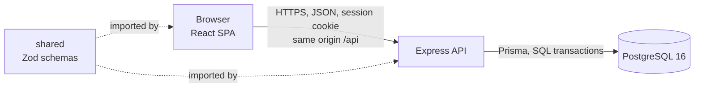
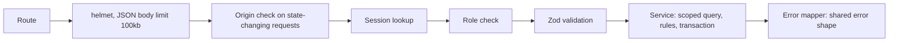
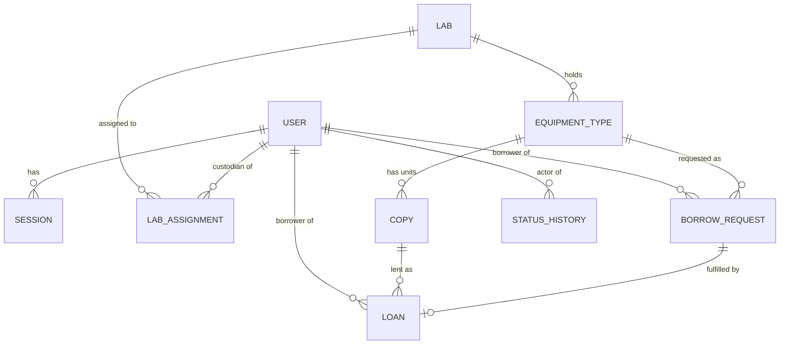
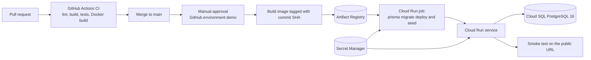

# System-Level Software Design Specification

Product: Lab Equipment Borrowing System
Source: [SRS v0.5](srs.md)
Issue: #3

## Version history

| Version | Date | Author | Change |
| --- | --- | --- | --- |
| 0.1 | 2026-11-04 | @ArmmyC | First System-Level SDS for teammate review. Includes fixes from an independent check against Part C, the SRS, the scaffold code, and the Lab 5 kit. |

## 1. Purpose and scope

This document defines the design decisions that every feature shares: the architecture, the data model, the UI and API conventions, authorization, authentication, time handling, configuration, and the deployment plan. Each Sprint feature contract in `docs/sprints/` adds the detailed screens, endpoints, fields, and tests for one feature and must follow this document. A contract that needs a different design changes this document in the same pull request.

Requirement IDs (FR, BR, NFR, D) refer to the [SRS](srs.md).

## 2. Architecture

### 2.1 Stack

| Layer | Technology | Folder |
| --- | --- | --- |
| UI | React 19, Vite 7, React Router 7, Bootstrap 5 | `client/` |
| API and application logic | Node.js 24, Express 5, helmet | `server/` |
| Shared request and response schemas | Zod 4, TypeScript | `shared/` |
| Database | PostgreSQL 16, accessed through Prisma 6 | `server/prisma/` |
| Tests | Vitest and Supertest (server), Vitest and Testing Library (client), Playwright (end to end) | `*/tests/`, `e2e/` |
| Delivery (Lab 5) | Docker, GitHub Actions, Google Cloud Run, Cloud SQL, Secret Manager, Artifact Registry | `Dockerfile`, `.github/`, `deploy/` |

The repository is one npm workspace with three packages. `shared` is built first and imported by both `server` and `client`, so the API and the UI validate the same shapes.

### 2.2 Components and communication



| Component | Responsibility | Does not do |
| --- | --- | --- |
| React SPA | Screens, navigation, form input, client-side validation for fast feedback, display of dates in Asia/Bangkok time | Decide permissions or business rules. Hiding a button is never authorization. |
| Express API | Authentication, authorization, request validation, business rules, transactions, error mapping, and, in production, serving the built SPA | Keep any state in memory between requests |
| Service layer inside the API | One module per domain area (auth, catalog, requests, checkout, loans, copies, history). Each state change runs in one database transaction. | Read HTTP objects. Routes translate HTTP to service calls. |
| PostgreSQL | Durable storage of every record, sessions included, and the last line of defence for integrity rules through constraints and indexes | Hold business logic in triggers or stored procedures |
| shared | Request and response schemas, the error shape, and enum values used by both sides | Contain logic that touches the database |

The browser always calls the API on the same origin under `/api`. In development the Vite server on port 5190 proxies `/api` to the API on port 4100. In production one container serves both the built SPA and `/api` on the port in `PORT`, so no CORS configuration is needed.

### 2.3 Request flow inside the API



### 2.4 Where business rules are enforced

| Rule | Enforced in the service | Enforced in the database |
| --- | --- | --- |
| BR-01 one active loan per copy | Checkout changes the copy from Available to On loan with a conditional update and refuses when no row changes | Partial unique index on `loan(copy_id) WHERE status = 'ACTIVE'` |
| BR-02 copy must be Available, of the requested type, in the same lab | Checkout reads the copy inside the transaction and compares type and status | Foreign keys from copy to type and type to lab |
| BR-03 request needs an Available copy | Request service counts Available copies before inserting | None, because BR-17 lets the count change before checkout |
| BR-04 one Pending request or active loan per type per borrower | Request service locks the borrower's `user` row, then checks both inside the transaction (section 2.5) | Partial unique index on `borrow_request(borrower_id, equipment_type_id) WHERE status = 'PENDING'` |
| BR-05 loan period and due date | Checkout computes the due date (section 8) | Column default 7 and `CHECK (loan_period_days BETWEEN 1 AND 30)` |
| BR-06, BR-07, BR-08 allowed status changes | A transition table per entity in the service, used by every state change | Conditional updates include the expected old status in the `WHERE` clause |
| BR-12 unique asset tags | Service maps the violation to a 409 error (section 2.5) | Unique index on `copy(asset_tag)` |
| BR-15, BR-16 access scope | Every query is filtered by the session user (section 6) | Ownership columns are `NOT NULL` foreign keys |
| BR-09 to BR-11, BR-13, BR-14 (Sprint 2 and 3) | Added to the same services by their contracts | Constraints added by their migrations where a rule can be expressed in SQL |

The client repeats simple checks such as required fields only to give quick feedback. The API never trusts a client-supplied user ID, role, status, or lab.

### 2.5 Concurrency

Transactions run at PostgreSQL's default READ COMMITTED isolation level. Each statement sees the latest committed data, so rules that read and then write rely on row locks and conditional updates, not on an earlier read.

**Checkout** (BR-01, BR-02, BR-06, NFR-05). The transaction is:

1. Look up the request within the custodian's assigned labs. A missing or out-of-scope request returns 404. Then lock the borrower's row with `SELECT id FROM "user" WHERE id = :borrowerId FOR UPDATE`. Taking this lock first, the same as request creation, keeps the two transactions in one lock order so they cannot deadlock.
2. `UPDATE borrow_request SET status = 'FULFILLED' WHERE id = :requestId AND status = 'PENDING'`. If 0 rows change, refuse with 409 `INVALID_STATUS` and roll back. Two checkouts of the same request with different copies stop here.
3. Look up the copy within the custodian's assigned labs. A missing or out-of-scope copy returns 404 (D-08). A copy of another type, or in a lab other than the request's lab, returns 409 `COPY_MISMATCH`.
4. `UPDATE copy SET status = 'ON_LOAN' WHERE id = :copyId AND status = 'AVAILABLE'`. If 0 rows change, refuse with 409 `COPY_NOT_AVAILABLE` and roll back.
5. Insert the loan, and insert one history entry for each status change (section 3.4).
6. Commit.

PostgreSQL row locks make the step 2 and step 4 updates succeed for only one transaction. A second transaction waits for the first to commit, then sees the new status and changes 0 rows. The partial unique index on active loans and the unique `loan.request_id` are second guards.

**Request creation** (BR-03, BR-04, and later BR-10, BR-11). The transaction starts with `SELECT id FROM "user" WHERE id = :borrowerId FOR UPDATE`. This serializes all request creation for one borrower, and checkout locks the same row in its step 1. A checkout of the borrower's Pending request therefore cannot commit between the active-loan check and the Pending check. The same lock covers the Sprint 2 limits on active loans and overdue loans.

**Constraint errors.** Prisma reports a unique violation as error `P2002` with the constraint name. The error mapper turns each named constraint into its 409 rule code (`DUPLICATE_REQUEST`, `COPY_NOT_AVAILABLE`, `INVALID_STATUS`, `DUPLICATE_ASSET_TAG`), so a constraint that catches a race never shows as a 500.

**Connection pool.** Ten parallel checkouts wait on one row lock. The Prisma transaction options set `maxWait` to 10 seconds and `timeout` to 15 seconds, so waiting transactions get a 409 rather than a pool timeout (`P2028`). The NFR-05 test sends 10 checkouts of the same copy, each for a different borrower's Pending request, in parallel against the test database and expects exactly one 201 and nine 409 responses.

## 3. Data model

### 3.1 Diagram



### 3.2 Entities

All tables use an integer identity primary key `id`, and timestamps are `timestamptz` stored in UTC. Enum values are stored as PostgreSQL enums.

| Entity | Main fields | Constraints and notes |
| --- | --- | --- |
| `user` | `email`, `name`, `role` (`BORROWER`, `CUSTODIAN`), `password_hash`, `created_at` | `email` unique, stored lower-case. One role per account (SRS 4.2). |
| `session` | `user_id`, `token_hash`, `created_at`, `last_used_at`, `expires_at` | `token_hash` unique. `expires_at` is `created_at` plus 24 hours. Deleted on logout. See section 7. |
| `lab` | `name` | `name` unique |
| `lab_assignment` | `lab_id`, `custodian_id` | Primary key (`lab_id`, `custodian_id`). The service only assigns users with role `CUSTODIAN`. |
| `equipment_type` | `lab_id`, `name`, `category`, `description`, `loan_period_days` | Unique (`lab_id`, `name`). `loan_period_days` default 7, check 1 to 30 (BR-05). |
| `copy` | `equipment_type_id`, `asset_tag`, `status` (`AVAILABLE`, `ON_LOAN`, `IN_MAINTENANCE`, `RETIRED`) | `asset_tag` unique (BR-12). The lab of a copy is the lab of its type, so a copy cannot be in a different lab from its type. |
| `borrow_request` | `borrower_id`, `equipment_type_id`, `purpose` (optional, up to 500 characters), `status` (`PENDING`, `FULFILLED`, `REJECTED`, `CANCELLED`), `rejection_reason` (Sprint 2), `created_at`, `decided_at`, `decided_by_id` | Partial unique index for BR-04. `rejection_reason` is required when status is `REJECTED` (check constraint, Sprint 2). |
| `loan` | `request_id`, `copy_id`, `borrower_id`, `checked_out_at`, `checked_out_by_id`, `due_date` (`date`), `status` (`ACTIVE`, `RETURNED`), `returned_at`, `returned_by_id`, `return_note` (Sprint 2), `renewed_at` (Sprint 3) | `request_id` unique, so a request has at most one loan. Partial unique index for BR-01. `due_date` is a calendar date, not a timestamp (section 8). |
| `status_history` | `entity_type` (`REQUEST`, `LOAN`, `COPY`), `entity_id`, `lab_id`, `old_status` (null on creation), `new_status`, `actor_id`, `created_at` | Append only. `lab_id` lets the Sprint 2 history view filter by assigned lab. Index on (`entity_type`, `entity_id`). |
| `login_attempt` (Sprint 2) | `email`, `attempted_at`, `succeeded` | Supports the NFR-06 rate limit. Index on (`email`, `attempted_at`). |

Overdue (BR-09) is calculated from `due_date` and the current Bangkok date. It is not stored, so it can never be stale.

### 3.3 Ownership links

| Record | Owner used for access checks |
| --- | --- |
| Borrow request | `borrow_request.borrower_id` for the borrower. `equipment_type.lab_id` through the request's type for custodians. |
| Loan | `loan.borrower_id` for the borrower. The lab of the loan's copy for custodians. |
| Copy and equipment type | `equipment_type.lab_id` for custodians. Borrowers read catalog fields only. |
| History entry | `status_history.lab_id` for custodians. Borrowers have no access. |

### 3.4 History recording

Every service that changes a request, loan, or copy status calls one history function inside the same transaction, with the actor from the session. A refused change rolls back, so it records nothing. The table is written from Sprint 1 (FR-17, D-11), and the custodian view comes in Sprint 2.

### 3.5 Migrations and seed data

- `server/prisma/schema.prisma` is the source of the schema. Each change is a Prisma migration committed under `server/prisma/migrations/`.
- Constraints that Prisma cannot express, such as the partial unique indexes and the loan period check, are added as SQL in the same migration file, with a comment naming the business rule.
- Migrations are additive within a sprint, so an older image still works after a rollback (Lab 5). A destructive change gets its own reviewed migration and a note in the contract.
- Prisma does not track the SQL-only indexes and checks. The reviewer of every new migration checks that it does not drop or recreate them, and the API tests for BR-01, BR-04, BR-05, and BR-12 fail if one goes missing.
- Development: `prisma migrate dev`. Tests, CI, and production: `prisma migrate deploy`.
- `npm run db:seed` loads the A-04 synthetic data: 2 labs, 2 custodians assigned to different labs, 3 borrowers, about 6 equipment types, and copies in Available, On loan, and In maintenance states, including one loan created through the normal checkout service so its history exists.
- The seed is safe to run on every deploy. It only creates records that are missing, found by natural keys (email, lab name, type name in a lab, asset tag). It never updates an existing row, so copy statuses, requests, and loans changed by users survive a redeploy (NFR-10). It creates the sample loan only when the database has no loans yet.
- Seed account passwords come from the `SEED_USER_PASSWORD` environment variable and are never written in code, logs, or screens. The seed refuses to run without it.
- Tests reset the test database before each test file and create their own fixtures, so tests never depend on the development seed.

## 4. UI design

### 4.1 Screens and navigation

| Screen | Route | Role | Sprint | Purpose |
| --- | --- | --- | --- | --- |
| Login | `/login` | Anyone | 1 | Email and password form |
| Catalog | `/catalog` | Borrower | 1 | Equipment types grouped by lab with Available counts. Search and filters in Sprint 3. |
| Equipment detail | `/catalog/:typeId` | Borrower | 1 | Description, lab, loan period, Available count, and the request form |
| My requests and loans | `/my` | Borrower | 1 | Own requests with a Cancel button for Pending ones, and own loans with asset tag and due date. Overdue badge in Sprint 2. |
| Pending requests | `/custodian/requests` | Custodian | 1 | Oldest first, for assigned labs. Checkout opens a copy selection dialog. Reject in Sprint 2. |
| Active loans | `/custodian/loans` | Custodian | 1 | Borrower, asset tag, checkout date, due date. Overdue filter in Sprint 2. Return and renew actions in Sprint 2 and 3. |
| Copies | `/custodian/copies` | Custodian | 1 | Copies in assigned labs with a status switch. Add and retire in Sprint 2. |
| Equipment types | `/custodian/types` | Custodian | 2 | Create and edit types |
| History | `/custodian/history` | Custodian | 2 | History entries, with copy and borrower history in Sprint 3 |
| Summary | `/custodian/summary` | Custodian | 3 | Inventory summary per lab |

After login a borrower lands on the catalog and a custodian on pending requests. The header shows the user's name and role and a Logout button on every page. On page load the SPA calls `GET /api/auth/me` to restore the user (FR-03). A route for the other role, or any route while logged out, redirects to the user's home page or to login. This is for usability only, and the API enforces every permission again.

### 4.2 Shared UI behaviour

| Behaviour | Rule |
| --- | --- |
| Loading | Every list and detail screen shows a spinner with text while its request is in flight. |
| Empty | Every list shows a sentence that says what is missing and, where useful, what to do next, for example "No pending requests in your labs." |
| Error | A failed load shows the API `message` and a Retry button. A 401 `UNAUTHENTICATED` response sends the user to login. The login form's own 401 `INVALID_CREDENTIALS` stays on the form. |
| Form validation | Forms validate with the shared Zod schema before submitting, then show the API `fields` messages next to the matching inputs. A rule refusal (409) shows the API `message` above the form. Submit buttons are disabled while a request is in flight. |
| Confirmation | Cancel, checkout, and status changes show a confirmation step and then a success message, and the list reloads from the API. |
| Dates | Timestamps are shown as `D MMM YYYY, HH:mm` in Asia/Bangkok time. Due dates are shown as calendar dates. |
| Accessibility and layout | Bootstrap forms with labels, keyboard-reachable controls, and layouts that work on a phone browser (SRS 4.2). |

## 5. API conventions

### 5.1 Paths and methods

- All endpoints are under `/api` and exchange JSON with `Content-Type: application/json`.
- Resources use plural nouns. Reads use `GET`, creation uses `POST` and returns 201, partial updates use `PATCH`, and actions that are not plain updates use `POST` to a sub-path such as `/cancel` or `/checkout`.
- Borrower endpoints return only the caller's own records. Custodian endpoints are under `/api/custodian` and return only records in assigned labs.
- List endpoints return `{ "items": [...] }` so paging can be added later without breaking clients.
- IDs in paths are integers. A non-integer ID returns 404, the same as a missing record.
- Filters are query parameters on the list endpoints, for example `?status=`, `?labId=`, `?borrowerId=`, `?overdue=true`, and `?q=` for name search. Unknown parameters are refused with 400.

### 5.2 Planned endpoints

The feature contracts define each endpoint's fields and errors. This list fixes the paths.

| Method and path | Role | Sprint | Purpose |
| --- | --- | --- | --- |
| `GET /api/health` | Public | 1 | Liveness. Target response `{ "status": "ok" }` without a database call. The Sprint 1 scaffold still checks the database here, and the Lab 5 cloud-ready Issue moves that check to `/api/ready`. |
| `GET /api/ready` | Public | Lab 5 | Readiness. `{ "status": "ready", "database": "connected" }`, or 503 `{ "status": "not_ready" }` when the database check fails within 2 seconds. Used by the deploy smoke test. |
| `POST /api/auth/login` | Public | 1 | Start a session |
| `POST /api/auth/logout` | Signed in | 1 | End the session |
| `GET /api/auth/me` | Signed in | 1 | Current user |
| `GET /api/equipment-types` | Borrower | 1 | Catalog grouped by lab. Search and filters (`?q=`, `?category=`, `?labId=`, `?available=true`) in Sprint 3. |
| `GET /api/equipment-types/:id` | Borrower | 1 | Type detail |
| `POST /api/requests` | Borrower | 1 | Submit a request |
| `GET /api/requests` | Borrower | 1 | Own requests |
| `POST /api/requests/:id/cancel` | Borrower | 1 | Cancel own Pending request |
| `GET /api/loans` | Borrower | 1 | Own loans |
| `GET /api/custodian/requests?status=PENDING` | Custodian | 1 | Pending requests in assigned labs. Filters by status, lab, and borrower in Sprint 3. |
| `GET /api/custodian/requests/:id/available-copies` | Custodian | 1 | Copies that can be chosen for checkout |
| `POST /api/custodian/requests/:id/checkout` | Custodian | 1 | Record checkout with `{ "copyId" }` |
| `GET /api/custodian/loans?status=ACTIVE` | Custodian | 1 | Active loans in assigned labs. `?overdue=true` in Sprint 2, lab and borrower filters in Sprint 3. |
| `GET /api/custodian/copies` | Custodian | 1 | Copies in assigned labs |
| `PATCH /api/custodian/copies/:id` | Custodian | 1, 2 | Change status. Sprint 1 allows Available and In maintenance. Sprint 2 adds Retired. On loan is never accepted as a target. |
| `POST /api/custodian/requests/:id/reject` | Custodian | 2 | Reject with a reason |
| `POST /api/custodian/loans/:id/return` | Custodian | 2 | Record a return |
| `POST`, `PATCH /api/custodian/equipment-types` | Custodian | 2 | Create and edit types |
| `POST /api/custodian/copies` | Custodian | 2 | Add a copy |
| `GET /api/custodian/history` | Custodian | 2 | History entries in assigned labs |
| `POST /api/custodian/loans/:id/renew` | Custodian | 3 | Renew a loan |
| `GET /api/custodian/copies/:id/loans` | Custodian | 3 | Loan history of a copy |
| `GET /api/custodian/borrowers/:id/loans` | Custodian | 3 | Loan history of a borrower within assigned labs |
| `GET /api/custodian/summary` | Custodian | 3 | Inventory summary |

### 5.3 Responses and errors

A successful response returns the resource or `{ "items": [...] }`. Every error uses the NFR-07 shape from `shared/src/api-error.ts`:

```json
{ "error": { "code": "VALIDATION_ERROR", "message": "Check the highlighted fields.", "fields": { "copyId": "Choose a copy." } } }
```

| Status | `code` | When |
| --- | --- | --- |
| 400 | `VALIDATION_ERROR` | The body or query fails the Zod schema. `fields` names each invalid field. |
| 400 | `INVALID_JSON` | The body is not valid JSON |
| 401 | `UNAUTHENTICATED` | No valid session |
| 401 | `INVALID_CREDENTIALS` | Wrong email or password on login, with one generic message that does not say which field was wrong (FR-01) |
| 403 | `FORBIDDEN` | The session's role may not call this endpoint (D-08) |
| 403 | `INVALID_ORIGIN` | A state-changing request comes from another origin (section 7.4) |
| 404 | `NOT_FOUND` | The record does not exist, belongs to another borrower, or is in an unassigned lab (D-08). This includes a `copyId` in a request body that the custodian cannot see. |
| 413 | `PAYLOAD_TOO_LARGE` | The body is over 100kb. The scaffold maps this to 500 today, and the F-01 work adds the mapping. |
| 409 | A rule code, for example `COPY_NOT_AVAILABLE`, `COPY_MISMATCH`, `DUPLICATE_REQUEST`, `NO_AVAILABLE_COPY`, `INVALID_STATUS`, `DUPLICATE_ASSET_TAG` | A business rule refuses the change, including a unique constraint that catches a race (section 2.5). Nothing is changed. |
| 429 | `TOO_MANY_ATTEMPTS` | Login rate limit (NFR-06, Sprint 2) |
| 500 | `INTERNAL_ERROR` | An unexpected error. The response never contains a stack trace, SQL, or internal IDs. The server logs the details. |

Each contract lists the rule codes its endpoints return.

## 6. Roles and permissions

### 6.1 Permission matrix

Scope "own" means records where the borrower is the session user. Scope "assigned labs" means records whose equipment type belongs to a lab in the custodian's `lab_assignment` rows.

| Operation | Borrower | Custodian | Not signed in | Sprint |
| --- | --- | --- | --- | --- |
| Log in | Yes | Yes | Yes | 1 |
| Log out, read current user | Yes | Yes | 401 | 1 |
| Browse catalog and type detail | Yes, availability counts only | 403 | 401 | 1 |
| Submit a request | Yes, for self | 403 | 401 | 1 |
| List requests and loans | Own | 403 on borrower endpoints | 401 | 1 |
| Cancel a Pending request | Own | 403 | 401 | 1 |
| List Pending requests | 403 | Assigned labs | 401 | 1 |
| List copies and the copies available for a checkout | 403 | Assigned labs | 401 | 1 |
| Record checkout | 403 | Assigned labs | 401 | 1 |
| List active loans | 403 | Assigned labs | 401 | 1 |
| Change copy status (Available, In maintenance) | 403 | Assigned labs | 401 | 1 |
| Reject a request, record a return | 403 | Assigned labs | 401 | 2 |
| Create and edit types, add and retire copies | 403 | Assigned labs | 401 | 2 |
| View history | 403 | Assigned labs | 401 | 2 |
| Renew a loan, view copy and borrower history, view summary | 403 | Assigned labs | 401 | 3 |
| Search and filter the catalog | Yes | 403 | 401 | 3 |
| Filter requests and loans by status, lab, and borrower | 403 | Assigned labs | 401 | 3 |

A borrower who names another borrower's record, or a custodian who names a record in an unassigned lab, gets 404 (D-08).

### 6.2 Backend enforcement

1. `requireSession` middleware loads the session from the cookie and returns 401 when it is missing, unknown, or expired. It is applied to every route except login, `/api/health`, and `/api/ready`.
2. `requireRole('BORROWER')` or `requireRole('CUSTODIAN')` returns 403 for the wrong role. It is applied per router, so a new endpoint inherits it.
3. Services receive the session user, never a user ID from the request. Every query adds the scope filter (`borrower_id = user.id`, or `lab_id IN` the custodian's assigned labs). A record outside the scope is not found, so the 404 comes from the same code path as a missing record and reveals nothing.
4. Routes are registered from one route table in `server/src/routes.ts`, where each entry names its method, path, and whether it is public. The NFR-02 test reads the same table and calls every non-public entry without a session, so a new endpoint is tested as soon as it is registered.

## 7. Authentication and sessions

### 7.1 Passwords

- Hashed with scrypt from `node:crypto`, with a random 16-byte salt per password, N = 16384, r = 8, p = 1, and a 64-byte key (NFR-01).
- Stored as one string `scrypt$N$r$p$salt$hash` with base64 salt and hash, so the parameters can be raised later.
- Verified with `timingSafeEqual`. For an unknown email the server still verifies against a fixed dummy hash, so response time does not reveal which emails exist.
- Accounts are seeded (A-01). There is no registration, password change, or recovery screen (SRS 4.2).

### 7.2 Session lifecycle

| Step | Behaviour |
| --- | --- |
| Login | Validate the body, look up the lower-cased email, verify the password. On success create a token of 32 random bytes (base64url), store only its SHA-256 hash in `session.token_hash`, and set the cookie. On failure return 401 with one generic message and create nothing (FR-01). |
| Cookie | Name `sid`, `HttpOnly`, `SameSite=Lax`, `Path=/`, `Max-Age` 24 hours, and `Secure` when `NODE_ENV=production`. |
| Each request | Hash the cookie value, find the session, and refuse it when `now >= expires_at` or `now >= last_used_at + 8 hours` (NFR-04). Expired rows are deleted when found. An accepted request sets `last_used_at` to `now`, so a session used at 7 hours 59 minutes of inactivity is accepted and one at exactly 8 hours is refused. |
| Current user | `GET /api/auth/me` returns `id`, `name`, `email`, and `role` (FR-03). |
| Logout | Delete the session row and clear the cookie. Reusing the old cookie then returns 401 (FR-02). |
| Cleanup | Login deletes the user's expired sessions. No background job is needed at this size. |

Sessions live in PostgreSQL, so they survive a restart and work across several Cloud Run instances (NFR-10).

### 7.3 Login rate limit (Sprint 2)

`login_attempt` records each attempt that reaches the password check. After 10 failed attempts for one email within 15 minutes, every login for that email returns 429 until the window ends, and a successful login before the limit resets the count (NFR-06). Attempts refused with 429 are not recorded, so they do not extend the window.

Known trade-off: anyone who knows an email can lock that account for 15 minutes by failing 10 times. We accept this because accounts are seeded, the window is short, and a per-IP limit is harder to test behind Cloud Run. This was agreed in the PR #6 review.

### 7.4 CSRF protection

The session cookie is `SameSite=Lax`, so browsers do not send it on cross-site `POST`, `PATCH`, or `DELETE`. As a second layer, the API refuses any state-changing request whose `Origin` header is present and is not in the `APP_ORIGIN` allow list, with 403 `INVALID_ORIGIN`. All state changes use `POST` or `PATCH` with a JSON body, never `GET`. This avoids a separate CSRF token because the UI and API share one origin.

`APP_ORIGIN` is a comma-separated list because one app has several valid origins:

| Environment | `APP_ORIGIN` value |
| --- | --- |
| Development | `http://localhost:5190,http://127.0.0.1:5190` |
| Tests and E2E | `http://127.0.0.1:5190`, the Playwright `baseURL`. API tests send no `Origin` header, so they are not affected. |
| Cloud Run | Both service URLs Cloud Run assigns. The first deploy runs without the variable, then the deploy script reads the URLs with `gcloud run services describe` and sets them, and later deploys keep them. |

The Vite proxy's `changeOrigin` option rewrites the `Host` header but not `Origin`, so the check compares `Origin` with the allow list and never with `Host`.

## 8. Time handling

| Concern | Design |
| --- | --- |
| Storage | Timestamps (`created_at`, `checked_out_at`, and so on) are `timestamptz` in UTC. |
| Due date | `loan.due_date` is a `date`. It is the checkout date in Asia/Bangkok plus `loan_period_days` (BR-05). The service reads the Bangkok calendar date of `clock.now()` with `Intl.DateTimeFormat` and the `Asia/Bangkok` time zone, adds whole days to it as a plain `YYYY-MM-DD` value, and builds the `Date` for Prisma only with `Date.UTC(year, month - 1, day)`. No step depends on the server's `TZ` setting, so a container with `TZ=Asia/Bangkok` cannot shift the stored date by one day. |
| Overdue | A loan is overdue when today's Asia/Bangkok date is after `due_date` (BR-09). It is calculated when read. |
| Display | The client formats timestamps in Asia/Bangkok time and shows due dates as plain dates. |
| Testable clock | Services read time from an injected `clock.now()` function and write every timestamp from it, including session and domain timestamps. Columns have no database `now()` defaults, so tests control every time value. Tests pass a fixed clock to check 23:59 and 00:00 Bangkok time (NFR-08) and session expiry (NFR-04). Production uses the system clock. |

## 9. Configuration and secrets

### 9.1 Environment variables

| Variable | Used by | Secret | Development value comes from | Production value comes from |
| --- | --- | --- | --- | --- |
| `DATABASE_URL` | API, migrations, seed | Yes | `.env` (placeholder in `.env.example`) | Secret Manager |
| `PORT` | API | No | `.env`, default 4100 | Set by Cloud Run |
| `NODE_ENV` | API (secure cookie, log format) | No | Unset (development) | `production` in the image |
| `APP_ORIGIN` | API (Origin check) | No | `.env` and `.env.test`, see section 7.4. The F-01 work adds it to both example files. | Cloud Run environment variable with both service URLs (section 7.4) |
| `SMOKE_EMAIL`, `SMOKE_PASSWORD` | Deploy smoke test only | Yes (password) | Not used | GitHub environment `demo` variable and secret |
| `SEED_USER_PASSWORD` | Seed only | Yes | `.env` | Secret Manager, read by the migration job only |
| `POSTGRES_USER`, `POSTGRES_PASSWORD`, `POSTGRES_DB` | Local Docker Compose only | Yes (password) | `.env` and `.env.test` | Not used. Cloud SQL users are created by the Lab 5 deploy script. |

The API needs no session signing secret, because session tokens are random and checked against the database.

### 9.2 Secret handling rules

- `.env` and `.env.test` are ignored by Git. Only `.env.example` and `.env.test.example` with placeholders are committed (NFR-13).
- The client bundle reads no secrets. Vite only exposes variables prefixed `VITE_`, and the project defines none that are secret.
- Logs never print passwords, tokens, cookies, or `DATABASE_URL`.
- GitHub secret scanning and push protection stay on for the public repository.
- In GCP, runtime secrets live in Secret Manager and are injected into Cloud Run as environment variables. Pipeline settings are GitHub environment variables, and GitHub signs in to GCP through Workload Identity Federation with no key file.
- If a secret is ever pushed, it is changed at once, the app is redeployed, and a TA is told. Deleting the file is not enough.

## 10. Deployment plan (Lab 5)

Actual cloud setup is part of Lab 5. The application is designed for it now.



| Component | Design |
| --- | --- |
| Image | One multi-stage Dockerfile. The build stage runs `npm ci` and `npm run build` from the repository root, because `server` imports the `@cpe334-group/shared` workspace package. The runtime stage runs `npm ci --omit=dev --ignore-scripts` from the root and copies in `shared/dist`, `server/dist`, `server/prisma` (schema, migrations, and the seed), the generated Prisma client, and `client/dist`. It runs as a non-root user and listens on `PORT`. |
| Cloud Run service | Serves the SPA and `/api` from the one image. Minimum 0 and maximum 3 instances. Public access for the demo and Lab 6. |
| Cloud SQL | PostgreSQL 16, smallest tier, storage auto-increase off, in the same region as Cloud Run (`asia-southeast1`). Connected through the Cloud Run Cloud SQL connector. |
| Migrations | A Cloud Run job runs `prisma migrate deploy` and the seed before the service is updated. `prisma` is a runtime dependency for this reason. |
| Secrets | `DATABASE_URL` and `SEED_USER_PASSWORD` in Secret Manager. The runtime service account can read only those secrets and connect to Cloud SQL. |
| Pipeline | CI runs on every pull request into the sprint staging branch and `main`, and a failing check blocks the merge (NFR-11). A merge into `main` starts the deploy workflow, which waits for a manual approval on the `demo` environment, then builds, pushes, migrates, deploys by image digest, and runs a read-only smoke test. |
| Smoke test | Read-only checks after each deploy: `GET /api/health`, `GET /api/ready`, `GET /` (the SPA), then a login as a dedicated smoke borrower (`SMOKE_EMAIL`, `SMOKE_PASSWORD`), `GET /api/equipment-types`, and logout. It never uses a custodian account and changes no data. |
| Release identity | The image tag is the full commit SHA, and the run summary records the tag, digest, and URL, so the running revision maps to one commit. |
| Rollback | Redeploy an earlier image tag through the same workflow. Migrations are additive, so an older image still works. |
| Durability | All state, sessions included, is in Cloud SQL. Nothing is written to the container disk (NFR-10). |
| Cost | A budget alert before any resource, Cloud SQL paused when idle, and teardown after grading. |

## 11. Known trade-offs and limits

| Decision | Trade-off | Why we accept it |
| --- | --- | --- |
| Login lockout per email (NFR-06) | Anyone who knows an email can lock it for 15 minutes | Seeded accounts and a short window. See section 7.3. |
| No CSRF token | Relies on `SameSite=Lax` and the Origin check | One origin for UI and API, and all state changes use JSON `POST` or `PATCH` |
| Pending requests do not reserve copies (D-05) | A borrower's request can outlive the last Available copy | Borrower cancel (FR-10, D-12) lets them withdraw it in Sprint 1, and reject arrives in Sprint 2 |
| Overdue is calculated, not stored | Every read compares dates | No stale flags and no scheduled job |
| Partial indexes written in SQL inside Prisma migrations | Prisma does not show them in `schema.prisma` | Each one has a comment naming its business rule, and API tests cover the behaviour |
| One time zone (A-06) | No per-user time zones | The department works in Asia/Bangkok only |
| Lab-scoped custodian access (D-06, Q-05) | Depends on the TA's answer to Q-05 | If the answer changes, the scope filter in section 6.2 changes in one place |

## 12. Requirement coverage of this design

| Requirement | Section |
| --- | --- |
| BR-01, NFR-05 | 2.4, 2.5, 3.2 |
| BR-02 to BR-08, BR-12, BR-17 | 2.4, 2.5, 3.2 |
| BR-10, BR-11, BR-13, BR-14 (Sprint 2 and 3) | 2.4, 2.5 (borrower row lock), 3.2 |
| BR-15, BR-16, NFR-02, NFR-03, D-08 | 3.3, 6 |
| FR-01 to FR-03, NFR-01, NFR-04 | 7.1, 7.2 |
| NFR-06 | 7.3 |
| FR-17, D-11 | 3.4 |
| BR-05, BR-09, NFR-08 | 8 |
| NFR-07 | 4.2, 5.3 |
| NFR-09 | 3.5 |
| NFR-10 | 7.2, 10 |
| NFR-11 | 10 |
| NFR-12 | 2.3 (service layer that unit and API tests target). Coverage is measured from Sprint 2. |
| NFR-13 | 9 |
| NFR-14 | 10 (Cloud Run and Cloud SQL in one region). Measured in Sprint 3. |
| FR-04 to FR-16, FR-18 to FR-21 | 4.1, 5.2, 6.1 (screens, endpoints, and permissions), detailed in the feature contracts |
